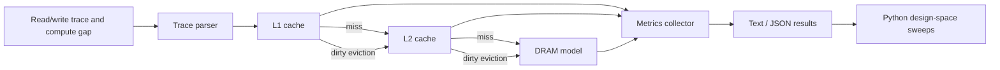

# SoCPerfSim

[](https://github.com/VT2305/socperfsim/actions/workflows/ci.yml)

**Trace-driven C++17 memory-system simulator for exploring L1/L2 cache and DRAM design trade-offs.**

> **Status:** In development. The simulator core, tests, synthetic trace generator, and Python design-space sweep tooling are implemented. Hardware-calibrated workloads and larger benchmark studies are planned.

## Why I built this

Modern application performance is often limited by data movement rather than arithmetic alone. SoCPerfSim is a small, transparent simulator for studying how cache capacity, associativity, replacement policy, latency, and DRAM characteristics affect memory-system behaviour.

I built it to get closer to the systems side of performance engineering: not just *what* a program computes, but how the memory hierarchy changes the cost of executing it.

## What it models

- configurable **L1 + L2 set-associative caches**
- **LRU, FIFO, and random** replacement
- write-back + write-allocate behaviour
- configurable cache capacity, associativity, line size, and hit latency
- configurable DRAM latency and bandwidth
- read/write traces with optional compute-cycle gaps
- dirty evictions and DRAM write traffic
- aggregate performance metrics in text or JSON

## Metrics

The simulator reports:

| Metric | Meaning |
|---|---|
| L1 / L2 hit rate | locality captured at each cache level |
| AMAT | average memory-access time in simulated cycles |
| DRAM reads / writes | off-chip line transfers |
| DRAM traffic | bytes transferred to/from memory |
| Memory stall cycles | cycles spent servicing memory accesses |
| Total cycles | compute gaps + memory-service cycles |
| Simulated time | total cycles converted using the configured CPU frequency |

## Architecture



## Repository structure

```text
socperfsim/
├── include/socperfsim/
│   ├── cache.hpp
│   ├── config.hpp
│   ├── simulator.hpp
│   └── trace.hpp
├── src/
│   ├── cache.cpp
│   ├── simulator.cpp
│   ├── trace.cpp
│   └── main.cpp
├── tests/
│   └── test_cache.cpp
├── python/
│   ├── generate_traces.py
│   ├── sweep.py
│   └── summarize.py
├── traces/
│   └── demo.csv
├── configs/
│   └── sweep_example.json
├── docs/
│   ├── ARCHITECTURE.md
│   ├── BENCHMARKING.md
│   └── TRACE_FORMAT.md
├── results/
│   └── README.md
├── CMakeLists.txt
└── .github/workflows/ci.yml
```

## Build

Requirements:

- C++17 compiler
- CMake 3.16+
- Python 3.10+ for sweep tooling

```bash
cmake -S . -B build
cmake --build build --config Release
```

Run tests:

```bash
ctest --test-dir build --output-on-failure
```

## Run a simulation

```bash
./build/socperfsim traces/demo.csv
```

Example with explicit cache parameters:

```bash
./build/socperfsim traces/demo.csv \
  --l1-size 32768 \
  --l1-assoc 8 \
  --l1-line 64 \
  --l1-policy lru \
  --l1-latency 4 \
  --l2-size 262144 \
  --l2-assoc 8 \
  --l2-line 64 \
  --l2-policy lru \
  --l2-latency 12 \
  --dram-latency-cycles 200 \
  --dram-bandwidth-gbps 25 \
  --cpu-ghz 3.0
```

For machine-readable output:

```bash
./build/socperfsim traces/demo.csv --json
```

## Trace format

CSV:

```text
op,address,compute_cycles
R,0x1000,12
W,0x1040,3
R,0x1080,0
```

- `op`: `R` or `W`
- `address`: hexadecimal or decimal byte address
- `compute_cycles`: optional cycles between this memory operation and the previous one

See [`docs/TRACE_FORMAT.md`](docs/TRACE_FORMAT.md).

## Generate synthetic workloads

The trace generator can create intentionally different access patterns:

```bash
python python/generate_traces.py --output-dir traces/generated
```

It produces:

- `compute_like.csv` — small repeatedly reused working set
- `streaming.csv` — mostly sequential accesses
- `ar_like.csv` — mixed sequential + reused buffers

These are synthetic educational workloads, not claimed to reproduce any commercial processor or application.

## Design-space sweeps

Build the simulator first, then:

```bash
python python/sweep.py \
  --simulator ./build/socperfsim \
  --trace traces/generated/streaming.csv \
  --config configs/sweep_example.json \
  --output results/streaming_sweep.csv
```

The sweep tool varies parameters from the JSON configuration and stores one row per experiment.

Example questions:

- How much does doubling L1 capacity improve a streaming trace?
- When does higher associativity stop helping?
- How sensitive is AMAT to L2 latency?
- Which configuration reduces DRAM traffic most?
- How do LRU and FIFO differ on a conflict-heavy trace?

## Implementation notes

### Cache indexing

For a byte address:

```text
block = address / line_size
set   = block % number_of_sets
tag   = block / number_of_sets
```

Each set tracks valid/dirty state plus metadata required by the selected replacement policy.

### Writes

The simulator uses:

- **write-back**
- **write-allocate**

A dirty L1 eviction is written into L2. A dirty L2 eviction generates a DRAM write.

### DRAM transfer cost

DRAM service cost is approximated as:

```text
fixed DRAM latency + cache-line transfer time
```

where transfer time depends on configured bandwidth and CPU frequency.

This is intentionally a simplified performance model. It does not attempt to reproduce bank-level DRAM scheduling, MSHRs, prefetchers, out-of-order overlap, coherence, or non-blocking caches.

## Tests

Current tests verify:

- address mapping and hit/miss behaviour
- LRU replacement
- dirty eviction state
- deterministic behaviour for non-random policies

```bash
ctest --test-dir build --output-on-failure
```

## Planned extensions

- multi-level prefetching experiments
- MSHR / memory-level parallelism model
- configurable inclusive/exclusive hierarchy behaviour
- DRAM bank/row-buffer model
- binary trace format for larger workloads
- benchmark plots generated from real sweep outputs

## Tech stack

`C++17` · `CMake` · `Python` · `Computer Architecture` · `Performance Modeling`

---

Built to explore **how memory-hierarchy design decisions translate into measurable performance behaviour**.

## Reproduced smoke-test result

Built with GCC 13.3 in Release mode on Linux, 25 October 2026. The CTest executable passed its three cache cases. Running `traces/demo.csv` with default configuration produced:

| Accesses | L1 hits | DRAM reads | AMAT (cycles) | Total cycles |
|---:|---:|---:|---:|---:|
| 8 | 3 | 5 | 141.5 | 1,165 |

These are outputs of an eight-access synthetic trace, not measured processor performance. See [benchmarking](docs/BENCHMARKING.md) for how to design a larger comparison.
